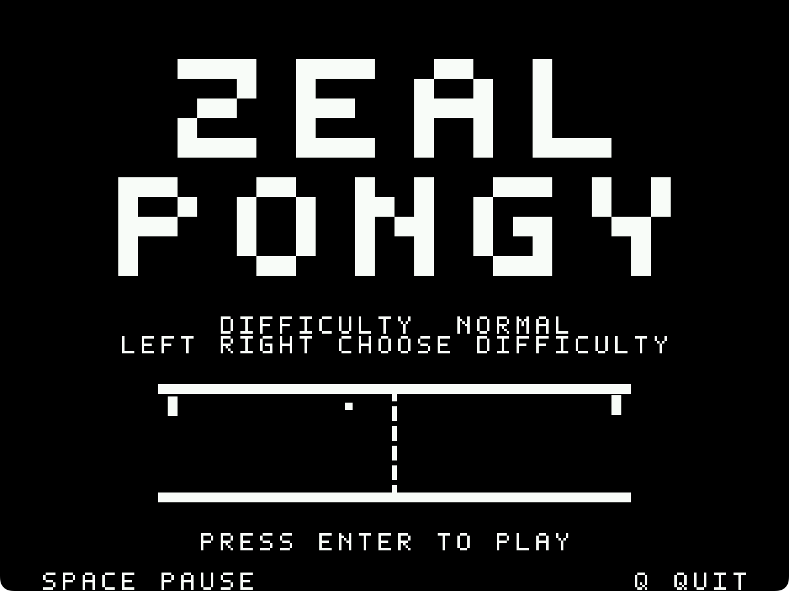
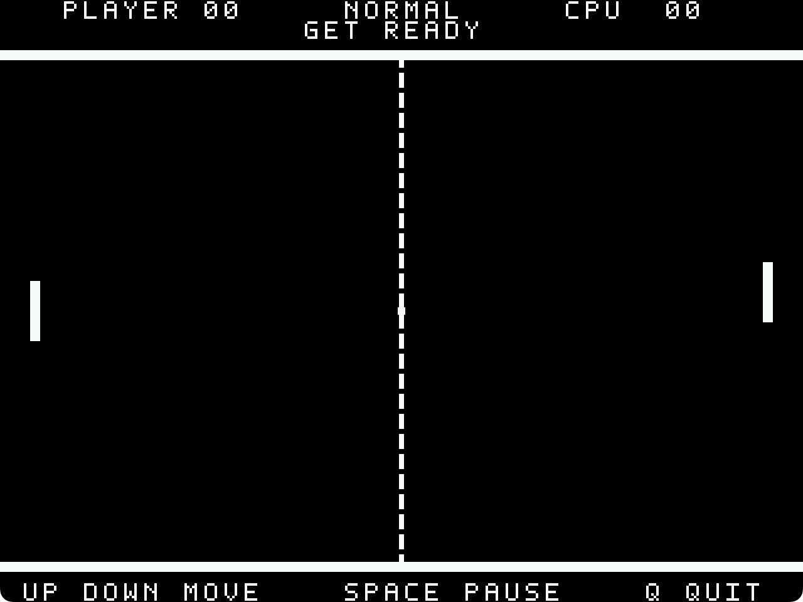

[](./LICENSE)

# zeal-pongy

zeal-pongy is a classic paddle game for the Zeal 8-bit Computer, with three computer difficulty levels, angled returns, sound effects and an animated **ZEAL / PONGY** splash screen.

It runs at **640×480 @8bpp**, with a black-and-white arcade style.

## Screenshots

| Splash Screen | Gameplay |
| - | - |
|  |  |

## Rules

- Return the ball past the computer's paddle to score a point.
- First to **11 points**, leading by **two**, wins. At **20–20**, the next point wins.
- Where the ball hits your paddle and how you move it influence the return angle.
- Rally speed increases up to a limit, with a short ready interval between points.
- Choose **Easy**, **Normal** or **Hard** on the splash screen.
- After a match, the result stays on screen until you choose to play again.

## Controls

- `UP` / `DOWN`, `W` / `S`, or SNES D-pad: move the paddle.
- `LEFT` / `RIGHT` on the splash: choose difficulty.
- `ENTER` or SNES `START`: start or replay.
- `SPACE`, `P`, SNES `B`, or `START` during play: pause or resume.
- `Q`, `RIGHT_SHIFT`, or SNES `SELECT`: quit.

Keyboard movement takes priority after an arrow or W/S press. Press controller `START` to switch back. Opposing movement buttons cancel.

## Game Flow

1. Choose a difficulty on the splash screen.
2. Press `ENTER` or SNES `START` at the flashing **PRESS ENTER TO PLAY** prompt.
3. Move your paddle and return the ball to outscore the computer.
4. After the match, read the result and press Start to play again.

## Build

Build from the project directory using ZDE, which supplies the Docker build environment:

```sh
zde cmake
```

The playable binary is **`bin/zpong`**. Assets are embedded; `make` uses the same ZDE build.

To launch in Zeal Native Emulator, start `zeal-native` from this project folder, then enter:

```text
H:
cd bin
./zpong
```
## Development

After building, run the gameplay, input, audio and rendering checks:

```sh
python3 tools/run_checks.py
```

## Credits

Original project contributors include **@zoul0813**. Licensed under [Apache 2.0](./LICENSE).
